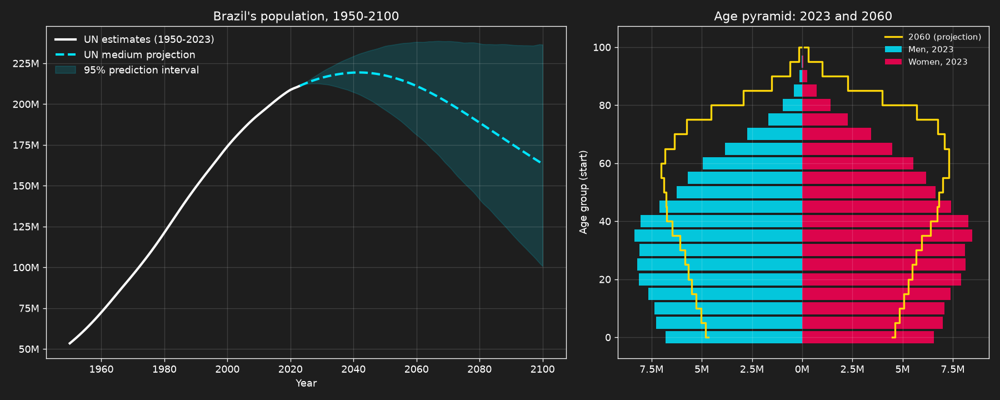
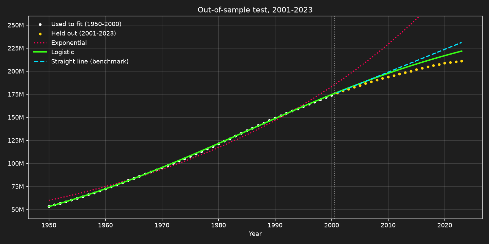
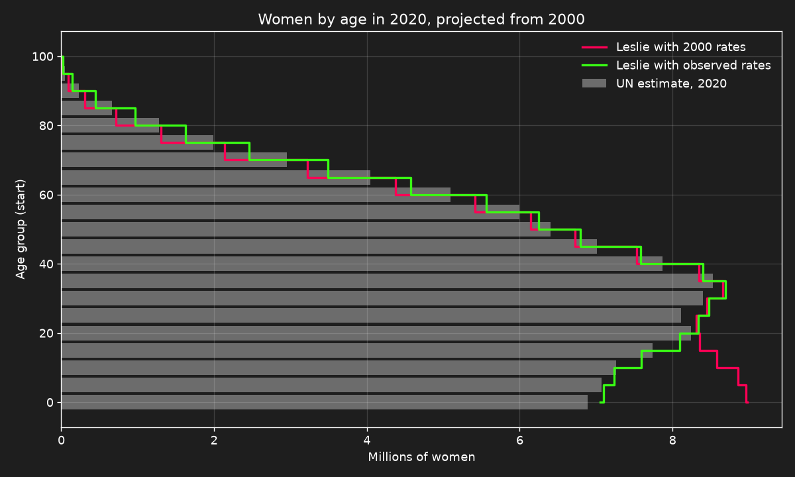
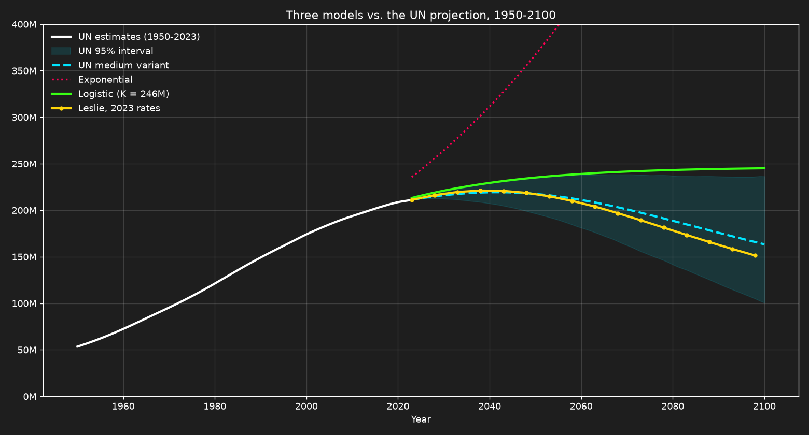

# Population Dynamics Models

Three classic population models (exponential, logistic and the Leslie matrix) applied to **Brazil's real population data** from the UN [World Population Prospects 2024](https://population.un.org/wpp/), and tested on years they did not see. Written in **Python** in a Jupyter notebook.



## Main results

* **Out-of-sample test (fitted on 1950-2000, forecasting 2001-2023):**
  * The exponential model (Malthus) forecasts 307 million people for 2023, against 211 million: a 45% error.
  * The logistic model (Verhulst) misses 2023 by 5.0%, with a 2.4% average error, and beats a straight-line benchmark (3.8%).
* **Leslie matrix, projecting women from 2000 to 2020:**
  * With the 2000 fertility and mortality rates held fixed, the error reaches 4.9%, because women had fewer children and lived longer than in 2000.
  * With the rates of each period, the error falls to 1.5%. The model works; the hard part is forecasting the rates.
* **To 2100:**
  * Fertility in 2023 was 1.62 children per woman, below the 2.1 needed to replace a generation.
  * With 2023 rates, the population still grows for about two decades and then falls to 151 million in 2098, inside the UN 95% interval (101 to 236 million).
  * The logistic model cannot represent a decline and stays at 245 million, above that interval.







## Repository structure

* `population_dynamics_models.ipynb`: The notebook with the theory, code and results.
* `population_dynamics_models.html`: The same notebook exported for reading in the browser.
* `data/`: Brazil's rows of the UN files (total population, population by age, fertility by age, female life table), plus `download_wpp.py`, the script that downloads and filters them.
* `figures/`: The main charts, saved by the notebook.

## How to run

```bash
pip install numpy pandas matplotlib scipy jupyter
jupyter notebook population_dynamics_models.ipynb
```

The data are already in `data/`. To download them again from the UN (about 270 MB of raw files), run `python data/download_wpp.py`.
